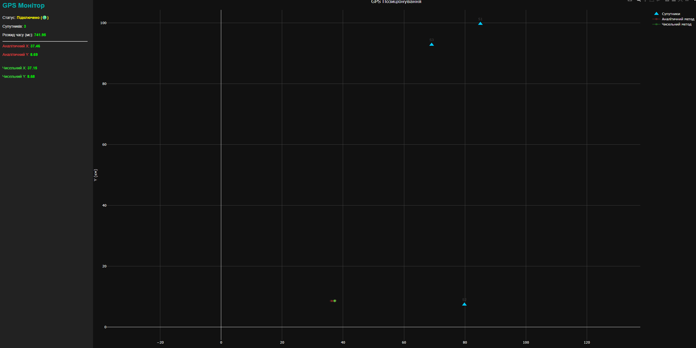

# Лабораторна робота №3: Розробка додатку для візуалізації вимірювань GPS

## 1. Опис роботи
**Мета:** Розробити веб-додаток, який зчитує дані з емулятора GPS по WebSocket, розраховує позицію об'єкта та відображає її на графіку.

**Обраний варіант реалізації чисельного методу:** 
*Варіант 2 (Середній рівень: Власна реалізація функції мінімізації на JS).*
Замість використання зовнішніх бібліотек, був написаний власный алгоритм градієнтного спуску (Gradient Descent) безпосередньо в JavaScript. Метод ітеративно (за 100 кроків) мінімізує сумарну квадратичну похибку між обчисленими і фактичними відстанями. У якості початкового наближення (стартової точки `startX`, `startY`) для чисельного алгоритму передається результат аналітичного методу, що гарантує миттєву та правильну збіжність градієнта.

## 2. Інструкція із запуску
Запустіть емулятор GPS за допомогою Docker:
   ```
   docker run --rm --name gps-emulator -p 21701:4000 iperekrestov university:gps-emulation-service-2026
   ```
Відкрийте файл index.html у будь-якому сучасному веб-браузері. Додаткових залежностей або локальних серверів не потрібно.

## 3. Обґрунтування порогу розкиду часу вимірювань
Поріг розкиду часу (MAX_TIME_SPREAD) встановлено на рівні 100 мс.Обґрунтування: Дані містять природну похибку розрахунку відстані (стандартне відхилення близько 90 метрів). Якщо об'єкт рухається навіть із високою швидкістю автомобіля (наприклад, 100 км/год, що дорівнює ~27.7 м/с), за 100 мілісекунд він переміститься лише на 2.7 метра. Зміщення на 2-3 метра є абсолютно незначним у порівнянні з власною похибкою вимірювання (90 метрів). Таким чином, 100 мс є безпечним вікном, яке гарантує, що розрахунок не "розірветься" через рух, і при цьому система не відкидатиме занадто багато пакетів даних.

## 4. Результати та висновки


Порівняння методів:На візуалізації чітко видно відмінність у поведінці розрахунків.Аналітичний метод (червоний слід) дає значний "розкид" і координати сильно стрибають навколо реального положення. Це відбувається через те, що пряме розв'язання рівнянь жорстко реагує на похибки (шум) у виміряних відстанях до супутників.   Чисельний метод (зелений слід) поводиться набагато стабільніше. Метод найменших квадратів згладжує похибки, балансуючи помилки від різних супутників. Як результат, траєкторія, обчислена чисельно, виглядає більш плавною та ближчою до реального руху об'єкта.